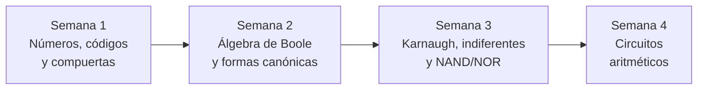

<div align="center">

# Cuaderno de Diseño de Circuitos

### Unidad 1 · Análisis de lógica combinacional con diseño clásico


---

**Universidad Nacional de Loja**
**Carrera de Computación · 2.º ciclo A**

---

| | |
|:---|:---|
| **Asignatura** | Diseño de Circuitos |
| **Estudiante** | Jhoan Alexander Rojas Guaman |
| **Docente** | Ing. Luis Darío Sinche Cueva, Mg. |
| **Período académico** | Septiembre 2026 – Marzo 2027 |
| **Ciudad** | Loja, Ecuador |

</div>

---

## Presentación

Este cuaderno reúne, semana a semana, el resumen de lo aprendido en la **Unidad 1** de Diseño de Circuitos. Parte de los números y las compuertas lógicas y llega hasta un circuito aritmético completo (el corazón de una ALU), siguiendo el **diseño clásico**: enunciado → tabla de verdad → expresión → simplificación → circuito.

> [!NOTE]
> **Resultado de aprendizaje R1:** diseña e implementa circuitos combinacionales básicos utilizando técnicas de diseño clásico.

---

## Índice

| Semana | Tema | Qué se aprende | Ir a la semana |
|:---:|:---|:---|:---:|
| **1** | Sistemas numéricos, códigos y compuertas lógicas | Conversión entre bases, complemento a dos, BCD, Gray, ASCII y las 7 compuertas | [Abrir](semanas/semana-01.md) |
| **2** | Álgebra de Boole y formas canónicas | Postulados, teoremas, De Morgan, minitérminos, maxitérminos, SOP y POS | [Abrir](semanas/semana-02.md) |
| **3** | Mapas de Karnaugh, indiferentes y NAND/NOR | Minimización SOP/POS, condiciones indiferentes, implementación con una sola familia | [Abrir](semanas/semana-03.md) |
| **4** | Circuitos aritméticos | Semisumador, sumador completo, sumador de 4 bits, resta, overflow y comparador | [Abrir](semanas/semana-04.md) |

---

## Ruta de aprendizaje



Cada semana construye sobre la anterior:

1. **Semana 1:** se aprende el "idioma" del hardware (bits, códigos, compuertas).
2. **Semana 2:** se aprende a describir un circuito con una expresión y a simplificarla con álgebra.
3. **Semana 3:** se simplifica de forma sistemática con mapas y se implementa con una sola familia de compuertas.
4. **Semana 4:** se aplica todo lo anterior para diseñar un sumador/restador de 4 bits.

---

## Estructura del repositorio

```text
cuaderno-diseno-circuitos/
├── README.md                  ← Portada e índice (estás aquí)
└── semanas/
    ├── semana-01.md           ← Sistemas numéricos, códigos y compuertas
    ├── semana-02.md           ← Álgebra de Boole y formas canónicas
    ├── semana-03.md           ← Mapas de Karnaugh, indiferentes y NAND/NOR
    └── semana-04.md           ← Circuitos aritméticos
```

---

## Cómo navegar este cuaderno

- Cada semana tiene un **índice propio** al inicio, con enlaces a cada sección.
- Arriba y abajo de cada página hay una barra de navegación: **← anterior · índice · siguiente →**.
- Al final de cada semana hay un cuadro de **Ideas clave** para repasar rápido.
- Las fórmulas están escritas en notación matemática y se visualizan directamente en GitHub.

### Convenciones de notación

| Símbolo | Significado |
|:---:|:---|
| $A \cdot B$ o $AB$ | AND (producto) |
| $A + B$ | OR (suma) |
| $A'$ | NOT (complemento) |
| $A \oplus B$ | XOR |
| $\Sigma m(\dots)$ | Suma de minitérminos (SOP) |
| $\Pi M(\dots)$ | Producto de maxitérminos (POS) |
| $d(\dots)$ | Condiciones indiferentes |

---

<div align="center">

**Siguiente:** [Semana 1 · Sistemas numéricos, códigos y compuertas lógicas ➡️](semana-01.md)

</div>
