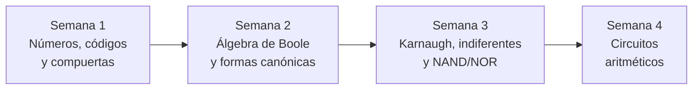

<div align="center">

# Cuaderno de Diseño de Circuitos

### Unidad 1 · Análisis de lógica combinacional con diseño clásico


---

**Universidad Nacional de Loja**
**Carrera de Computación · 2.º ciclo A**

---

| | |
|:---|:---|
| **Asignatura** | Diseño de Circuitos |
| **Estudiante** | Jhoan Alexander Rojas Guaman |
| **Docente** | Ing. Luis Darío Sinche Cueva, Mg. |
| **Período académico** | Septiembre 2026 – Marzo 2027 |
| **Ciudad** | Loja, Ecuador |

</div>

---

## Presentación

Este cuaderno resume, semana a semana, la teoría de la **Unidad 1** de Diseño de Circuitos y la complementa con **ejercicios propuestos** (con solución) para practicar. Va de los números y las compuertas lógicas hasta un circuito aritmético completo, siguiendo el **diseño clásico**: enunciado → tabla de verdad → expresión → simplificación → circuito.

> [!NOTE]
> **Resultado de aprendizaje R1:** diseña e implementa circuitos combinacionales básicos utilizando técnicas de diseño clásico.

---

## Índice

| Apartado | Tema | Qué incluye | Ir a |
|:---:|:---|:---|:---:|
| **Semana 1** | Sistemas numéricos, códigos y compuertas lógicas | Bases numéricas, complemento a dos, BCD, Gray, ASCII, compuertas y 74LS08 | [Abrir](semanas/semana-01.md) |
| **Semana 2** | Álgebra de Boole y formas canónicas | Postulados, teoremas, De Morgan, minitérminos, maxitérminos, SOP y POS | [Abrir](semanas/semana-02.md) |
| **Semana 3** | Mapas de Karnaugh, indiferentes y NAND/NOR | Minimización SOP/POS, condiciones indiferentes, implementación NAND-NAND | [Abrir](semanas/semana-03.md) |
| **Semana 4** | Circuitos aritméticos | Semisumador, sumador completo, ripple carry, resta, overflow y comparador | [Abrir](semanas/semana-04.md) |
| **Declaración** | Uso de inteligencia artificial | Herramienta, tareas y responsabilidad | [Abrir](declaracion-uso-ia.md) |

---

## Ruta de aprendizaje



Cada semana construye sobre la anterior: primero el «idioma» del hardware (bits, códigos, compuertas), luego describir y simplificar con álgebra, después simplificar de forma sistemática con mapas, y por último aplicar todo a un sumador/restador de 4 bits.

---

## Estructura del repositorio

```text
cuaderno-diseno-circuitos/
├── README.md                  ← Portada e índice (estás aquí)
├── declaracion-uso-ia.md      ← Declaración de uso de IA
└── semanas/
    ├── semana-01.md           ← Sistemas numéricos, códigos y compuertas
    ├── semana-02.md           ← Álgebra de Boole y formas canónicas
    ├── semana-03.md           ← Mapas de Karnaugh, indiferentes y NAND/NOR
    └── semana-04.md           ← Circuitos aritméticos
```

---

## Cómo navegar este cuaderno

- Cada semana tiene un **índice propio** al inicio, con enlaces a cada sección.
- Arriba y abajo de cada página hay una barra de navegación: **← anterior · índice · siguiente →**.
- Todas las semanas siguen el mismo orden: **objetivo → teoría → ejercicios propuestos → ideas clave**.
- Las soluciones de los ejercicios están ocultas: pulsa «Ver solución» para desplegarlas.
- Las fórmulas se visualizan directamente en GitHub.

### Convenciones de notación

| Símbolo | Significado |
|:---:|:---|
| $A \cdot B$ o $AB$ | AND (producto) |
| $A + B$ | OR (suma) |
| $A'$ | NOT (complemento) |
| $A \oplus B$ | XOR |
| $\Sigma m(\dots)$ | Suma de minitérminos (SOP) |
| $\Pi M(\dots)$ | Producto de maxitérminos (POS) |
| $d(\dots)$ | Condiciones indiferentes |

---

<div align="center">

**Siguiente:** [Semana 1 · Sistemas numéricos, códigos y compuertas lógicas ➡️](semanas/semana-01.md)

</div>
