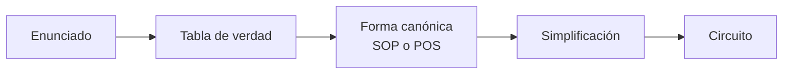

[🏠 Índice](README.md) · [⬅️ Semana 1](semana-01.md) · [Semana 3 ➡️](semana-03.md)

---

# Semana 2 · Álgebra de Boole y formas canónicas

> **Unidad 1:** Análisis de lógica combinacional con diseño clásico · **Diseño de Circuitos** · Computación, 2.º ciclo A · UNL

## Contenido de la semana

1. [Objetivo](#1-objetivo)
2. [Circuito y expresión](#2-circuito-y-expresión)
3. [Del enunciado a la especificación](#3-del-enunciado-a-la-especificación)
4. [Postulados y teoremas](#4-postulados-y-teoremas)
5. [Leyes de De Morgan](#5-leyes-de-de-morgan)
6. [Minitérminos y maxitérminos](#6-minitérminos-y-maxitérminos)
7. [Formas canónicas SOP y POS](#7-formas-canónicas-sop-y-pos)
8. [Simplificación algebraica](#8-simplificación-algebraica)
9. [Ejercicios propuestos](#9-ejercicios-propuestos)
10. [Ideas clave](#10-ideas-clave)

---

## 1. Objetivo

Pasar de un **enunciado** a la **tabla de verdad**, a la **forma canónica** y a un **circuito simplificado**.

[⬆️ Volver al contenido](#contenido-de-la-semana)

---

## 2. Circuito y expresión

Un circuito y una expresión son **lo mismo**:

| En el circuito | En la expresión |
|:---|:---:|
| Cable de entrada | Variable ($A, B, C \dots$) |
| Compuerta AND | Producto ($\cdot$) |
| Compuerta OR | Suma ($+$) |
| Compuerta NOT | Complemento ($'$) |
| Salida | Valor de la expresión |

Ejemplo: $Y = A \cdot B + C'$. **Precedencia:** NOT $\rightarrow$ AND $\rightarrow$ OR.

[⬆️ Volver al contenido](#contenido-de-la-semana)

---

## 3. Del enunciado a la especificación

Un enunciado ambiguo puede producir **dos funciones distintas**. Con «la sirena suena cuando se activan dos sensores»:

| Lectura | Significado | Función |
|:---|:---|:---:|
| **1** | **Exactamente** dos sensores (con tres activos no suena) | $F = \Sigma m(3,5,6)$ |
| **2** | **Al menos** dos sensores (la que suele pedir el cliente) | $F = \Sigma m(3,5,6,7)$ |

[⬆️ Volver al contenido](#contenido-de-la-semana)

---

## 4. Postulados y teoremas

El álgebra de Boole trabaja con el conjunto $\{0, 1\}$ y las operaciones $+$ (OR), $\cdot$ (AND) y $'$ (NOT).

### Postulados de Huntington

| Propiedad | Forma con suma | Forma con producto |
|:---|:---:|:---:|
| **Identidad** | $X + 0 = X$ | $X \cdot 1 = X$ |
| **Complemento** | $X + X' = 1$ | $X \cdot X' = 0$ |
| **Conmutativa** | $X + Y = Y + X$ | $X \cdot Y = Y \cdot X$ |
| **Distributiva** | $X(Y + Z) = XY + XZ$ | $X + YZ = (X + Y)(X + Z)$ |

**Dualidad:** si se intercambian $+$ y $\cdot$, y también $0 \leftrightarrow 1$ (sin complementar variables), la identidad sigue siendo válida.

### Teoremas

| Teorema | Forma con suma | Forma con producto |
|:---|:---:|:---:|
| **Elemento nulo** | $X + 1 = 1$ | $X \cdot 0 = 0$ |
| **Idempotencia** | $X + X = X$ | $X \cdot X = X$ |
| **Involución** | $(X')' = X$ | |
| **Absorción** | $X + XY = X$ | $X(X + Y) = X$ |
| **Absorción del complemento** | $X + X'Y = X + Y$ | $X(X' + Y) = XY$ |
| **Adyacencia** | $XY + XY' = X$ | $(X + Y)(X + Y') = X$ |
| **Consenso** | $XY + X'Z + YZ = XY + X'Z$ | $(X + Y)(X' + Z)(Y + Z) = (X + Y)(X' + Z)$ |

[⬆️ Volver al contenido](#contenido-de-la-semana)

---

## 5. Leyes de De Morgan

$$(A \cdot B)' = A' + B' \qquad\qquad (A + B)' = A' \cdot B'$$

> [!TIP]
> **Regla:** rompe la barra y cambia el operador.

[⬆️ Volver al contenido](#contenido-de-la-semana)

---

## 6. Minitérminos y maxitérminos

Para 3 variables $(A, B, C)$, de la fila 0 a la 7:

| | Minitérmino $m_i$ | Maxitérmino $M_i$ |
|:---|:---|:---|
| **Tipo** | Producto ($\cdot$) | Suma ($+$) |
| **Variable en 1** | Sin complemento | Complementada |
| **Variable en 0** | Complementada | Sin complemento |
| **Cuándo vale** | Solo vale **1** en su fila | Solo vale **0** en su fila |
| **Ejemplo, fila 3 ($011$)** | $A'BC$ | $A + B' + C'$ |

Relación: $M_i = (m_i)'$.

[⬆️ Volver al contenido](#contenido-de-la-semana)

---

## 7. Formas canónicas SOP y POS

| | **SOP** (Suma de Productos) | **POS** (Producto de Sumas) |
|:---|:---|:---|
| **Filas que se leen** | Donde $F = 1$ | Donde $F = 0$ |
| **Términos** | Minitérminos unidos con OR | Maxitérminos unidos con AND |
| **Ejemplo** | $\Sigma m(3,5,6,7) = A'BC + AB'C + ABC' + ABC$ | $\Pi M(0,1,2,4) = (A+B+C)(A+B+C')(A+B'+C)(A'+B+C)$ |

### ¿SOP o POS?

| Situación | Conviene |
|:---|:---|
| Pocos **1** en la tabla | SOP |
| Pocos **0** en la tabla | POS |
| Solo hay **NAND** | SOP, que se implementa NAND-NAND |
| Solo hay **NOR** | POS, que se implementa NOR-NOR |

> [!IMPORTANT]
> El criterio final es el **costo**: compuertas, circuitos integrados y niveles lógicos.

[⬆️ Volver al contenido](#contenido-de-la-semana)

---

## 8. Simplificación algebraica

### Procedimiento

1. **Pares adyacentes:** $XY + XY' = X$.
2. **Duplicar** si hace falta: $X = X + X$.
3. **Absorción:** $X + XY = X$.
4. **Absorción del complemento:** $X + X'Y = X + Y$.
5. **Consenso:** $XY + X'Z + YZ = XY + X'Z$.

**Resultado de aplicarlo a la función anterior** $\Sigma m(3,5,6,7)$: se duplica $ABC$ tres veces y se forman los pares $A'BC + ABC = BC$, $AB'C + ABC = AC$ y $ABC' + ABC = AB$, con lo que

$$F = AB + AC + BC$$

La forma canónica necesitaba 4 circuitos integrados (7404, 2 × 7411, 7432); la simplificada solo 2 (7408, 7432).

> [!WARNING]
> No hay un algoritmo que **garantice** el mínimo con álgebra de Boole pura. Para eso están los mapas de Karnaugh (Semana 3).

[⬆️ Volver al contenido](#contenido-de-la-semana)

---

## 9. Ejercicios propuestos

**Ejercicio 1.** Simplifica $F = AB + AB' + A'B$.

Ver solución

Por adyacencia, $AB + AB' = A$. Entonces $F = A + A'B$, y por absorción del complemento:

$$F = A + B$$

**Ejercicio 2.** Aplica De Morgan para obtener el complemento de $F = A'B + CD$ sin barras sobre sumas ni productos grandes.

Ver solución

$$F' = (A'B + CD)' = (A'B)' \cdot (CD)' = (A + B')(C' + D')$$

**Ejercicio 3.** Una alarma de casa suena ($F = 1$) cuando está activada ($A$) **y** se abre la ventana ($V$) **o** la puerta ($P$). Obtén la tabla de verdad, la SOP canónica, la POS canónica y la expresión simplificada.

Ver solución

$F = A(V + P)$, con $F = 1$ en las filas 5, 6 y 7 (orden $A, V, P$).

- SOP: $F = \Sigma m(5,6,7) = AV'P + AVP' + AVP$
- POS: $F = \Pi M(0,1,2,3,4) = (A+V+P)(A+V+P')(A+V'+P)(A+V'+P')(A'+V+P)$
- Simplificada: $AVP' + AVP = AV$ y $AV'P + AVP = AP$, de modo que $F = AV + AP$

**Ejercicio 4.** Convierte $F = \Sigma m(1,2,4,7)$ a su forma POS canónica y escribe los maxitérminos.

Ver solución

Las filas con $F = 0$ son las restantes: $0, 3, 5, 6$.

$$F = \Pi M(0,3,5,6) = (A+B+C)(A+B'+C')(A'+B+C')(A'+B'+C)$$

(Esta función vale 1 cuando hay un número impar de unos en las entradas.)

**Ejercicio 5.** Simplifica $F = AB + A'C + BC$ con el teorema que corresponda.

Ver solución

Es el teorema del **consenso**: $BC$ es el término de consenso de $AB$ y $A'C$, así que se elimina:

$$F = AB + A'C$$

**Ejercicio 6.** «La alarma suena si se activa un sensor.» Con tres sensores $A, B, C$, escribe las dos lecturas posibles como suma de minitérminos.

Ver solución

- **Exactamente uno:** $F = \Sigma m(1,2,4)$.
- **Al menos uno:** $F = \Sigma m(1,2,3,4,5,6,7)$ (todas las filas menos la 0).

[⬆️ Volver al contenido](#contenido-de-la-semana)

---

## 10. Ideas clave

> [!TIP]
> - Circuito y expresión son equivalentes: AND es producto, OR es suma, NOT es complemento.
> - **Aclarar el enunciado** antes de diseñar («exactamente dos» no es «al menos dos»).
> - **SOP:** se leen los **1** con minitérminos y OR. **POS:** se leen los **0** con maxitérminos y AND.
> - **De Morgan:** rompe la barra y cambia el operador.
> - Simplificar reduce compuertas, circuitos integrados y costo.
> - El álgebra pura no garantiza el mínimo: por eso existen los mapas de Karnaugh.

---

[🏠 Índice](README.md) · [⬅️ Semana 1](semana-01.md) · [Semana 3 ➡️](semana-03.md)
