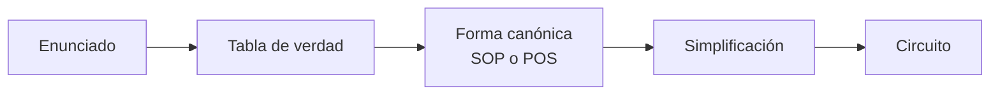

[🏠 Índice](../README.md) · [⬅️ Semana 1](semana-01.md) · [Semana 3 ➡️](semana-03.md)

---

# Semana 2 · Álgebra de Boole y formas canónicas

> **Unidad 1:** Análisis de lógica combinacional con diseño clásico · **Diseño de Circuitos** · Computación, 2.º ciclo A · UNL

## Contenido de la semana

1. [Objetivo de la semana](#1-objetivo-de-la-semana)
2. [Circuito y expresión](#2-circuito-y-expresión)
3. [Del enunciado a la especificación](#3-del-enunciado-a-la-especificación)
4. [Postulados y teoremas del álgebra de Boole](#4-postulados-y-teoremas-del-álgebra-de-boole)
5. [Leyes de De Morgan](#5-leyes-de-de-morgan)
6. [Minitérminos y maxitérminos](#6-minitérminos-y-maxitérminos)
7. [Formas canónicas SOP y POS](#7-formas-canónicas-sop-y-pos)
8. [Ejemplo guiado: alarma de 3 sensores](#8-ejemplo-guiado-alarma-de-3-sensores)
9. [Simplificación algebraica](#9-simplificación-algebraica)
10. [Ideas clave de la semana](#10-ideas-clave-de-la-semana)

---

## 1. Objetivo de la semana

Pasar de un **enunciado** a la **tabla de verdad**, a la **forma canónica** y a un **circuito simplificado**.

> [!NOTE]
> Aporta al **R1:** diseña e implementa circuitos combinacionales básicos utilizando técnicas de diseño clásico.

[⬆️ Volver al contenido](#contenido-de-la-semana)

---

## 2. Circuito y expresión

Un circuito y una expresión booleana son **lo mismo** escrito de dos formas:

| En el circuito | En la expresión |
|:---|:---:|
| Cable de entrada | Variable ($A, B, C \dots$) |
| Compuerta AND | Producto ($\cdot$) |
| Compuerta OR | Suma ($+$) |
| Compuerta NOT | Complemento ($'$) |
| Salida | Valor de la expresión |

**Ejemplo:** $Y = A \cdot B + C'$

**Precedencia de operaciones:** NOT $\rightarrow$ AND $\rightarrow$ OR.

[⬆️ Volver al contenido](#contenido-de-la-semana)

---

## 3. Del enunciado a la especificación

Un enunciado ambiguo puede dar **dos funciones distintas**. Ejemplo: *"La sirena suena cuando se activan dos sensores."*

| Lectura | Significado | Función |
|:---|:---|:---:|
| **1** | **Exactamente** dos sensores | $F = \Sigma m(3,5,6)$ |
| **2** | **Al menos** dos sensores | $F = \Sigma m(3,5,6,7)$ |

- En la lectura 1, con tres sensores activos **no suena**.
- La lectura 2 es la que suele pedir el cliente.

> [!TIP]
> Antes de diseñar, hay que **aclarar el enunciado** y escribir la especificación sin ambigüedad.

[⬆️ Volver al contenido](#contenido-de-la-semana)

---

## 4. Postulados y teoremas del álgebra de Boole

El álgebra de Boole trabaja con el conjunto $\{0, 1\}$ y tres operaciones: $+$ (OR), $\cdot$ (AND) y $'$ (NOT).

### Postulados de Huntington

| Propiedad | Forma con suma | Forma con producto |
|:---|:---:|:---:|
| **Identidad** | $X + 0 = X$ | $X \cdot 1 = X$ |
| **Complemento** | $X + X' = 1$ | $X \cdot X' = 0$ |
| **Conmutativa** | $X + Y = Y + X$ | $X \cdot Y = Y \cdot X$ |
| **Distributiva** | $X(Y + Z) = XY + XZ$ | $X + YZ = (X + Y)(X + Z)$ |

### Dualidad

Si se intercambian $+$ y $\cdot$ y también $0 \leftrightarrow 1$ (**sin complementar variables**), la identidad sigue siendo válida.

### Teoremas (tabla de consulta)

| Teorema | Forma con suma | Forma con producto |
|:---|:---:|:---:|
| **Elemento nulo** | $X + 1 = 1$ | $X \cdot 0 = 0$ |
| **Idempotencia** | $X + X = X$ | $X \cdot X = X$ |
| **Involución** | $(X')' = X$ | |
| **Absorción** | $X + XY = X$ | $X(X + Y) = X$ |
| **Absorción del complemento** | $X + X'Y = X + Y$ | $X(X' + Y) = XY$ |
| **Adyacencia** | $XY + XY' = X$ | $(X + Y)(X + Y') = X$ |
| **Consenso** | $XY + X'Z + YZ = XY + X'Z$ | $(X + Y)(X' + Z)(Y + Z) = (X + Y)(X' + Z)$ |

[⬆️ Volver al contenido](#contenido-de-la-semana)

---

## 5. Leyes de De Morgan

$$(A \cdot B)' = A' + B'$$

$$(A + B)' = A' \cdot B'$$

> [!TIP]
> **Regla práctica:** rompe la barra y cambia el operador.

[⬆️ Volver al contenido](#contenido-de-la-semana)

---

## 6. Minitérminos y maxitérminos

Para 3 variables $(A, B, C)$, de la fila 0 a la 7:

| Fila | $A$ | $B$ | $C$ | Minitérmino $m_i$ | Maxitérmino $M_i$ |
|:---:|:---:|:---:|:---:|:---:|:---:|
| 0 | 0 | 0 | 0 | $A'B'C'$ | $A + B + C$ |
| 1 | 0 | 0 | 1 | $A'B'C$ | $A + B + C'$ |
| 2 | 0 | 1 | 0 | $A'BC'$ | $A + B' + C$ |
| 3 | 0 | 1 | 1 | $A'BC$ | $A + B' + C'$ |
| 4 | 1 | 0 | 0 | $AB'C'$ | $A' + B + C$ |
| 5 | 1 | 0 | 1 | $AB'C$ | $A' + B + C'$ |
| 6 | 1 | 1 | 0 | $ABC'$ | $A' + B' + C$ |
| 7 | 1 | 1 | 1 | $ABC$ | $A' + B' + C'$ |

| | Minitérmino ($m_i$) | Maxitérmino ($M_i$) |
|:---|:---|:---|
| **Tipo de término** | Producto ($\cdot$) | Suma ($+$) |
| **Variable en 1** | Sin complemento | Complementada |
| **Variable en 0** | Complementada | Sin complemento |
| **Cuándo vale** | Solo vale **1** en su fila | Solo vale **0** en su fila |

Relación entre ambos: $M_i = (m_i)'$

[⬆️ Volver al contenido](#contenido-de-la-semana)

---

## 7. Formas canónicas SOP y POS

| | **SOP** (Suma de Productos) | **POS** (Producto de Sumas) |
|:---|:---|:---|
| **Filas que se leen** | Donde $F = 1$ | Donde $F = 0$ |
| **Términos usados** | Minitérminos | Maxitérminos |
| **Cómo se unen** | Con OR ($+$) | Con AND ($\cdot$) |
| **Ejemplo** | $F = \Sigma m(3,5,6,7)$ | $F = \Pi M(0,1,2,4)$ |

**Ejemplo SOP:**

$$F = \Sigma m(3,5,6,7) = A'BC + AB'C + ABC' + ABC$$

**Ejemplo POS:**

$$F = \Pi M(0,1,2,4) = (A+B+C)(A+B+C')(A+B'+C)(A'+B+C)$$

### ¿SOP o POS? Criterio de elección

| Situación | Conviene |
|:---|:---|
| Pocos **1** en la tabla | SOP (menos términos) |
| Pocos **0** en la tabla | POS (menos términos) |
| Solo hay compuertas **NAND** | SOP, que se implementa NAND-NAND |
| Solo hay compuertas **NOR** | POS, que se implementa NOR-NOR |

> [!IMPORTANT]
> El criterio final es el **costo**: cantidad de compuertas, circuitos integrados y niveles lógicos.

[⬆️ Volver al contenido](#contenido-de-la-semana)

---

## 8. Ejemplo guiado: alarma de 3 sensores

**Enunciado:** la sirena $F$ suena si **al menos 2** de los sensores $A$, $B$, $C$ se activan.

### Paso 1: tabla de verdad

| Fila | $A$ | $B$ | $C$ | $F$ |
|:---:|:---:|:---:|:---:|:---:|
| 0 | 0 | 0 | 0 | 0 |
| 1 | 0 | 0 | 1 | 0 |
| 2 | 0 | 1 | 0 | 0 |
| 3 | 0 | 1 | 1 | **1** |
| 4 | 1 | 0 | 0 | 0 |
| 5 | 1 | 0 | 1 | **1** |
| 6 | 1 | 1 | 0 | **1** |
| 7 | 1 | 1 | 1 | **1** |

### Paso 2: SOP canónica

$$F = A'BC + AB'C + ABC' + ABC$$

### Paso 3: simplificación algebraica

Se usa la **idempotencia** ($ABC = ABC + ABC + ABC$) y la **adyacencia** para formar tres pares:

$$A'BC + ABC = BC(A' + A) = BC$$

$$AB'C + ABC = AC(B' + B) = AC$$

$$ABC' + ABC = AB(C' + C) = AB$$

**Resultado final:**

$$\boxed{F = AB + AC + BC}$$

### Paso 4: comparar el costo

| Versión | Circuitos integrados necesarios |
|:---|:---|
| **Canónica** | **4 CI:** 7404, 2 × 7411, 7432 |
| **Simplificada** | **2 CI:** 7408, 7432 |

[⬆️ Volver al contenido](#contenido-de-la-semana)

---

## 9. Simplificación algebraica

### Procedimiento

1. **Pares adyacentes:** $XY + XY' = X$
2. **Duplicar** si hace falta: $X = X + X$
3. **Absorción:** $X + XY = X$
4. **Absorción del complemento:** $X + X'Y = X + Y$
5. **Consenso:** $XY + X'Z + YZ = XY + X'Z$

> [!WARNING]
> No existe un algoritmo que **garantice** el mínimo con álgebra de Boole pura. Para eso se usan los **mapas de Karnaugh** (Semana 3).

[⬆️ Volver al contenido](#contenido-de-la-semana)

---

## 10. Ideas clave de la semana

> [!TIP]
> - Circuito y expresión booleana son **equivalentes**: AND es producto, OR es suma, NOT es complemento.
> - Siempre **aclarar el enunciado** antes de diseñar ("exactamente dos" no es "al menos dos").
> - **SOP:** se leen los **1** y se usan minitérminos con OR. **POS:** se leen los **0** y se usan maxitérminos con AND.
> - **De Morgan:** rompe la barra y cambia el operador.
> - Simplificar reduce compuertas, circuitos integrados y costo (de 4 CI a 2 CI en la alarma).
> - El álgebra pura no garantiza el mínimo: por eso llegan los mapas de Karnaugh.

---

[🏠 Índice](../README.md) · [⬅️ Semana 1](semana-01.md) · [Semana 3 ➡️](semana-03.md)
