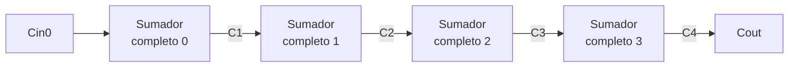
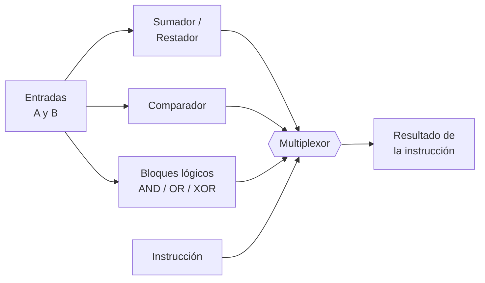

[🏠 Índice](README.md) · [⬅️ Semana 3](semana-03.md) · [Declaración de IA ➡️](declaracion-uso-ia.md)

---

# Semana 4 · Circuitos aritméticos

> **Unidad 1:** Lógica combinacional con diseño clásico · **Diseño de Circuitos** · Computación, 2.º ciclo A · UNL
>
> Semisumador, sumador completo, sumador de 4 bits, resta, overflow y comparador.

## Contenido de la semana

1. [Objetivo](#1-objetivo)
2. [Sumar un solo bit](#2-sumar-un-solo-bit)
3. [Semisumador y sumador completo](#3-semisumador-y-sumador-completo)
4. [Sumador de 4 bits ripple carry](#4-sumador-de-4-bits-ripple-carry)
5. [Resta: sumar el negativo](#5-resta-sumar-el-negativo)
6. [Overflow y comparador](#6-overflow-y-comparador)
7. [De aquí sale la ALU](#7-de-aquí-sale-la-alu)
8. [Ejercicios propuestos](#8-ejercicios-propuestos)
9. [Ideas clave](#9-ideas-clave)

---

## 1. Objetivo

Diseñar, con el procedimiento clásico, un circuito que **suma números binarios de 4 bits**, usarlo también para **restar** y **estimar cuánto tarda** en dar el resultado. Es el corazón de la **ALU** de un procesador.

[⬆️ Volver al contenido](#contenido-de-la-semana)

---

## 2. Sumar un solo bit

| $A + B$ | Resultado | Escribo ($S$) | Llevo ($C$) |
|:---:|:---:|:---:|:---:|
| $0 + 0$ | $0$ | 0 | 0 |
| $0 + 1$ | $1$ | 1 | 0 |
| $1 + 0$ | $1$ | 1 | 0 |
| $1 + 1$ | $10_2$ | 0 | 1 |

- $S$ = **suma** (el dígito que se escribe). $C$ = **carry** o acarreo (el que «me llevo»).
- Un acarreo puede aparecer en cualquier columna y provoca otro: **se encadenan**.

[⬆️ Volver al contenido](#contenido-de-la-semana)

---

## 3. Semisumador y sumador completo

Hay **dos tipos de columna, dos circuitos**:

| Columna | Qué suma | Circuito |
|:---:|:---|:---|
| **0** | 2 bits ($A$ y $B$); a su derecha no hay nada | Semisumador |
| **1, 2, 3…** | 3 bits ($A$, $B$ y el acarreo de entrada $C_{in}$) | Sumador completo |

### Semisumador

| Salida | Vale 1 cuando | Compuerta | Ecuación |
|:---:|:---|:---:|:---:|
| **$S$** | $A$ y $B$ son **distintos** | XOR | $S = A \oplus B$ |
| **$C$** | $A$ y $B$ son **ambos 1** | AND | $C = A \cdot B$ |

«Semi» porque no puede recibir acarreo: solo sirve para la columna 0.

### Sumador completo: el truco de contar unos

| Salida | Vale 1 cuando | En el mapa de Karnaugh | Ecuación |
|:---:|:---|:---|:---:|
| **$S$** | Hay un número **impar** de unos (1 o 3) | «Tablero de ajedrez», sin agrupaciones | $S = A \oplus B \oplus C_{in}$ |
| **$C_{out}$** | Hay **al menos dos** unos (la mayoría) | Tres grupos de dos | $C_{out} = AB + A \cdot C_{in} + B \cdot C_{in}$ |

> [!TIP]
> Para recordarlo: **$S$ = impar de unos, $C_{out}$ = al menos dos unos.**

[⬆️ Volver al contenido](#contenido-de-la-semana)

---

## 4. Sumador de 4 bits ripple carry

Cuatro sumadores completos conectados **en cadena**. Regla única: el $C_{out}$ de un sumador se conecta al $C_{in}$ del siguiente.

**«Ripple»:** el acarreo avanza como una ola; cada sumador espera el acarreo del anterior, así que el resultado se completa de **derecha a izquierda**.

**Estimación del retardo:** más bits significa más lento. Cada compuerta tarda $\approx 10\text{ ns}$ y el acarreo cruza $\approx 2$ compuertas por etapa:

$$\text{Retardo} \approx 2 \cdot n \cdot 10\text{ ns}$$

Para 4 bits $\approx 80\text{ ns}$ y para 32 bits $\approx 640\text{ ns}$.

[⬆️ Volver al contenido](#contenido-de-la-semana)

---

## 5. Resta: sumar el negativo

$A - B = A + (-B)$, donde $-B$ es invertir los bits de $B$ y sumar 1 (complemento a dos, Semana 1).

**XOR como inversor controlado:** cada bit de $B$ pasa por una XOR con la señal de control $M$.

| Control $M$ | Qué pasa con $B$ | Operación |
|:---:|:---|:---:|
| **0** | Pasa igual | **Suma** |
| **1** | Se invierte | **Resta** |

$M$ **también se conecta al $C_{in}$** del sumador de la columna 0, aportando el $+1$ del complemento a dos. Un solo circuito suma o resta según $M$.

[⬆️ Volver al contenido](#contenido-de-la-semana)

---

## 6. Overflow y comparador

### Overflow

Ocurre cuando el resultado **no cabe** en los bits asignados.

> [!WARNING]
> En números con signo, $C_{out} = 1$ **NO** significa error.

Hay overflow si el acarreo que **entra** a la última etapa es distinto del que **sale**:

$$V = C_3 \oplus C_4$$

### Comparador de magnitud ($A = B$?, $A > B$?)

| Comparación | Cómo se construye |
|:---|:---|
| **Igualdad** | Una compuerta **XNOR** en cada par de bits (1 si son iguales) y una **AND** grande con todas las salidas |
| **Magnitud** ($>$) | Desde la izquierda (**MSB**): el **primer bit en que difieren** decide quién es mayor |

Integrado comercial: **7485**.

[⬆️ Volver al contenido](#contenido-de-la-semana)

---

## 7. De aquí sale la ALU

La **ALU** (Unidad Aritmético Lógica) junta estos bloques: las salidas del sumador/restador, del comparador y de los bloques lógicos (AND/OR/XOR) entran a un **multiplexor** que elige el resultado de la instrucción.

[⬆️ Volver al contenido](#contenido-de-la-semana)

---

## 8. Ejercicios propuestos

**Ejercicio 1.** Suma $1101_2 + 0111_2$ columna por columna con un sumador de 4 bits ($C_{in0} = 0$). Anota $S$ y el acarreo de cada etapa.

Ver solución

| Columna | $A$ | $B$ | $C_{in}$ | $S$ | $C_{out}$ |
|:---:|:---:|:---:|:---:|:---:|:---:|
| 0 | 1 | 1 | 0 | 0 | 1 |
| 1 | 0 | 1 | 1 | 0 | 1 |
| 2 | 1 | 1 | 1 | 1 | 1 |
| 3 | 1 | 0 | 1 | 0 | 1 |

Resultado: $C_4\,S_3S_2S_1S_0 = 1\,0100 = 20$ ($13 + 7$). Sin signo, el $C_{out} = 1$ indica que no cabe en 4 bits.

**Ejercicio 2.** Estima el retardo del ripple carry para 8 y 16 bits. ¿Cuántas veces más lento es el de 16 que el de 4?

Ver solución

- 8 bits: $2 \cdot 8 \cdot 10 = 160\text{ ns}$.
- 16 bits: $2 \cdot 16 \cdot 10 = 320\text{ ns}$.

Como el de 4 bits tarda $80\text{ ns}$, el de 16 bits es **4 veces** más lento: el retardo crece linealmente con $n$.

**Ejercicio 3.** Calcula $5 - 3$ con el circuito sumador/restador de 4 bits. Indica $M$, el $B$ tras las XOR y el resultado.

Ver solución

Resta, entonces $M = 1$. $B = 0011$ pasa por las XOR y queda $1100$; $C_{in0} = M = 1$.

$0101 + 1100 + 1 = 1\,0010$. Se descarta el bit sobrante y el resultado es $0010 = 2$.

**Ejercicio 4.** Detecta con $V = C_3 \oplus C_4$ si hay overflow (4 bits con signo) en: **(a)** $0110 + 0101$ y **(b)** $0011 + 1110$.

Ver solución

**(a)** $6 + 5$: los acarreos son $C_3 = 1$ y $C_4 = 0$, así que $V = 1 \oplus 0 = 1$ (**overflow**). El resultado $1011$ se lee como $-5$, pero debía ser $11$.

**(b)** $3 + (-2)$: $C_3 = 1$ y $C_4 = 1$, así que $V = 1 \oplus 1 = 0$ (**sin overflow**). El resultado $0001 = 1$ es correcto aunque $C_{out} = 1$, lo que confirma que $C_{out} = 1$ no significa error con signo.

**Ejercicio 5.** ¿Con qué combinación de $A$, $B$ y $C_{in}$ un sumador completo produce $S = 1$ y $C_{out} = 1$ a la vez?

Ver solución

$S = 1$ exige un número **impar** de unos (1 o 3) y $C_{out} = 1$ exige **al menos dos**. Solo cumple ambas la combinación con **tres unos**: $A = B = C_{in} = 1$.

**Ejercicio 6.** Compara $A = 1010$ con $B = 1001$: indica las salidas XNOR por bit, si $A = B$ y cuál es mayor.

Ver solución

XNOR de izquierda a derecha: $1, 1, 0, 0$. La AND de todas vale 0, así que **$A \neq B$**.

Desde el MSB: los dos primeros bits son iguales y el tercero es el primero que difiere ($A$ tiene 1 y $B$ tiene 0), por lo tanto **$A > B$** ($10 > 9$).

[⬆️ Volver al contenido](#contenido-de-la-semana)

---

## 9. Ideas clave

> [!TIP]
> - **Semisumador** (columna 0): $S = A \oplus B$, $C = A \cdot B$.
> - **Sumador completo:** $S = A \oplus B \oplus C_{in}$ (impar de unos) y $C_{out} = AB + A \cdot C_{in} + B \cdot C_{in}$ (al menos dos unos).
> - **Ripple carry:** el $C_{out}$ de cada sumador va al $C_{in}$ del siguiente; más bits, más retardo.
> - **Resta:** XOR sobre $B$ controlada por $M$, y $M$ también entra al $C_{in}$ inicial.
> - **Overflow:** $V = C_3 \oplus C_4$, no el $C_{out}$.
> - **Comparador:** XNOR por bit + AND para igualdad; desde el MSB para magnitud.
> - Todo esto es la base de la **ALU**.

---

[🏠 Índice](README.md) · [⬅️ Semana 3](semana-03.md) · [Declaración de IA ➡️](declaracion-uso-ia.md)
