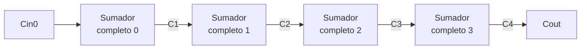
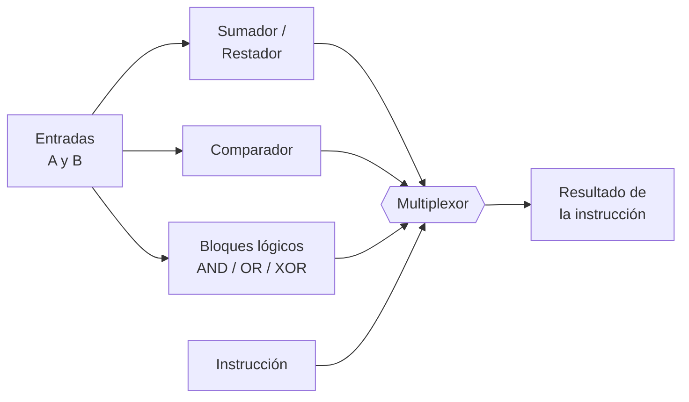

[🏠 Índice](../README.md) · [⬅️ Semana 3](semana-03.md)

---

# Semana 4 · Circuitos aritméticos

> **Unidad 1:** Lógica combinacional con diseño clásico · **Diseño de Circuitos** · Computación, 2.º ciclo A · UNL
>
> Semisumador, sumador completo, sumador de 4 bits, resta, overflow y comparador.

## Contenido de la semana

1. [Objetivo de la semana](#1-objetivo-de-la-semana)
2. [Sumar un solo bit](#2-sumar-un-solo-bit)
3. [Semisumador](#3-semisumador)
4. [Sumador completo](#4-sumador-completo)
5. [Sumador de 4 bits ripple carry](#5-sumador-de-4-bits-ripple-carry)
6. [Resta con el mismo circuito](#6-resta-con-el-mismo-circuito)
7. [Overflow](#7-overflow)
8. [Comparador de magnitud](#8-comparador-de-magnitud)
9. [De aquí sale la ALU](#9-de-aquí-sale-la-alu)
10. [Ideas clave de la semana](#10-ideas-clave-de-la-semana)

---

## 1. Objetivo de la semana

Diseñar, con el procedimiento clásico, un circuito que **suma números binarios de 4 bits**, usarlo también para **restar** y **estimar cuánto tarda** en dar el resultado. Es el corazón de la **ALU** de un procesador.

[⬆️ Volver al contenido](#contenido-de-la-semana)

---

## 2. Sumar un solo bit

| $A$ | $B$ | Resultado | $S$ (suma) | $C$ (acarreo) |
|:---:|:---:|:---:|:---:|:---:|
| 0 | 0 | $0$ | 0 | 0 |
| 0 | 1 | $1$ | 1 | 0 |
| 1 | 0 | $1$ | 1 | 0 |
| 1 | 1 | $10_2$ | 0 | 1 |

- $S$ = **suma**: el dígito que se escribe.
- $C$ = **carry** (acarreo): el que "me llevo".
- Un acarreo puede aparecer en cualquier columna, y un acarreo provoca otro: **se encadenan**.

### Dos tipos de columna, dos circuitos

| Columna | Qué suma | Circuito |
|:---:|:---|:---|
| **Columna 0** | 2 bits ($A$ y $B$); a su derecha no hay nada | Semisumador |
| **Columnas 1, 2, 3...** | 3 bits ($A$, $B$ y el acarreo de entrada $C_{in}$) | Sumador completo |

[⬆️ Volver al contenido](#contenido-de-la-semana)

---

## 3. Semisumador

Se obtiene leyendo la tabla de verdad de la sección anterior:

| Salida | Cuándo vale 1 | Compuerta | Ecuación |
|:---:|:---|:---:|:---:|
| **$S$** | $A$ y $B$ son **distintos** | XOR | $S = A \oplus B$ |
| **$C$** | $A$ y $B$ son **ambos 1** | AND | $C = A \cdot B$ |

> [!NOTE]
> Se llama **"semi"** porque no puede recibir acarreo, así que solo sirve para la columna 0.

[⬆️ Volver al contenido](#contenido-de-la-semana)

---

## 4. Sumador completo

Suma 3 bits: $A$, $B$ y $C_{in}$.

### Tabla de verdad

| $A$ | $B$ | $C_{in}$ | $S$ | $C_{out}$ |
|:---:|:---:|:---:|:---:|:---:|
| 0 | 0 | 0 | 0 | 0 |
| 0 | 0 | 1 | 1 | 0 |
| 0 | 1 | 0 | 1 | 0 |
| 0 | 1 | 1 | 0 | 1 |
| 1 | 0 | 0 | 1 | 0 |
| 1 | 0 | 1 | 0 | 1 |
| 1 | 1 | 0 | 0 | 1 |
| 1 | 1 | 1 | 1 | 1 |

### El truco: contar unos

| Salida | Vale 1 cuando... | En el mapa de Karnaugh | Ecuación |
|:---:|:---|:---|:---:|
| **$S$** | Hay un número **impar** de unos (1 o 3) | "Tablero de ajedrez" (sin agrupaciones) | $S = A \oplus B \oplus C_{in}$ |
| **$C_{out}$** | Hay **al menos dos** unos (la mayoría) | Tres grupos de dos | $C_{out} = AB + A \cdot C_{in} + B \cdot C_{in}$ |

> [!TIP]
> **Lo que se recuerda:** $S$ = impar de unos, $C_{out}$ = al menos dos unos.

[⬆️ Volver al contenido](#contenido-de-la-semana)

---

## 5. Sumador de 4 bits ripple carry

Cuatro sumadores completos conectados **en cadena**.

**Regla única:** el $C_{out}$ de un sumador se conecta al $C_{in}$ del siguiente.

- **"Ripple" (ola):** el acarreo avanza como una ola. Cada sumador espera el acarreo del anterior, así que el resultado se completa de **derecha a izquierda**.

### Estimación del retardo

Más bits significa más lento. Cada compuerta tarda $\approx 10\text{ ns}$ y el acarreo cruza $\approx 2$ compuertas por etapa:

$$\text{Retardo} \approx 2 \cdot n \cdot 10\text{ ns}$$

| Número de bits $n$ | Retardo aproximado |
|:---:|:---:|
| 4 bits | $\approx 80\text{ ns}$ |
| 32 bits | $\approx 640\text{ ns}$ |

[⬆️ Volver al contenido](#contenido-de-la-semana)

---

## 6. Resta con el mismo circuito

Se usa lo visto en la Semana 1 (complemento a dos):

$$A - B = A + (-B) \qquad\text{donde}\qquad -B = \text{invertir los bits de } B \text{ y sumar } 1$$

### XOR como inversor controlado

Cada bit de $B$ pasa por una compuerta XOR junto con la señal de control $M$:

| Control $M$ | Qué hace con $B$ | Operación |
|:---:|:---|:---:|
| **0** | $B$ pasa igual | **Suma** |
| **1** | $B$ se invierte | **Resta** |

$M$ **también se conecta al $C_{in}$** del sumador de la columna 0, aportando el $+1$ necesario para el complemento a dos.

> [!NOTE]
> Un solo circuito **suma o resta** según el control $M$.

[⬆️ Volver al contenido](#contenido-de-la-semana)

---

## 7. Overflow

**Overflow (desbordamiento):** ocurre cuando el resultado **no cabe** en los bits asignados.

> [!WARNING]
> En números con signo, $C_{out} = 1$ **NO** significa error.

**Cómo detectarlo:** hay overflow si el acarreo que **entra** a la última etapa es distinto del que **sale**:

$$V = C_3 \oplus C_4$$

[⬆️ Volver al contenido](#contenido-de-la-semana)

---

## 8. Comparador de magnitud

Responde a las preguntas $A = B$? y $A > B$?

| Comparación | Cómo se construye |
|:---|:---|
| **Igualdad** ($A = B$) | Una compuerta **XNOR** en cada par de bits (da 1 si son iguales) y una **AND grande** con todas las salidas |
| **Magnitud** ($A > B$) | Se compara desde la izquierda (**MSB**): el **primer bit en que difieren** decide quién es mayor |

Integrado comercial: **7485**.

[⬆️ Volver al contenido](#contenido-de-la-semana)

---

## 9. De aquí sale la ALU

La **ALU** (Unidad Aritmético Lógica) junta los bloques de esta semana: las salidas del sumador/restador, del comparador y de los bloques lógicos (AND/OR/XOR) entran a un **multiplexor** que elige el resultado de la instrucción.

[⬆️ Volver al contenido](#contenido-de-la-semana)

---

## 10. Ideas clave de la semana

> [!TIP]
> - **Semisumador** (columna 0): $S = A \oplus B$, $C = A \cdot B$.
> - **Sumador completo:** $S = A \oplus B \oplus C_{in}$ (impar de unos) y $C_{out} = AB + A \cdot C_{in} + B \cdot C_{in}$ (al menos dos unos).
> - **Ripple carry:** el $C_{out}$ de cada sumador va al $C_{in}$ del siguiente; más bits significa más retardo ($\approx 2 \cdot n \cdot 10\text{ ns}$).
> - **Resta:** XOR sobre $B$ controlada por $M$, y $M$ también entra al $C_{in}$ inicial.
> - **Overflow:** $V = C_3 \oplus C_4$, no el $C_{out}$.
> - **Comparador:** XNOR por bit + AND para igualdad; desde el MSB para magnitud.
> - Todo esto es la base de la **ALU**.

---

[🏠 Índice](../README.md) · [⬅️ Semana 3](semana-03.md)

**Fin de la Unidad 1** · Cuaderno de Diseño de Circuitos · Jhoan Alexander Rojas Guaman

